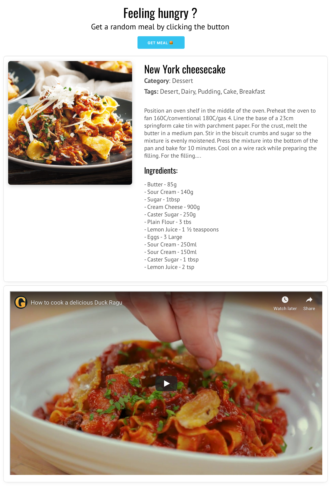

# randommeal

Press a button, get a meal. Or search one by name, and get the recipe, the
ingredients with their measurements, and the video.

Built on [TheMealDB](https://www.themealdb.com/api.php) with AngularJS,
TypeScript and webpack.



---

## Why it exists

I wrote this in late 2019 to teach myself modern front end tooling properly
rather than by osmosis. The commit history is the actual record of that: it
starts as plain JavaScript, becomes an AngularJS application, and then converts
to TypeScript with a bundler.

`Links.txt` in my working copy was the reading list I worked through alongside
it, covering ES6 modules, flexbox, BEM and Babel. This repository is what came
out the other end.

---

## How it is put together

**A service owns the network.** `mealService` has two methods, one for a random
meal and one for a search, and it is the only place in the app that knows the
API exists. Everything else asks it for a meal.

**The header is a component.** The random button and the search box, each of
which only changes the route. Neither knows what a meal looks like.

**The meal controller does the reshaping.** TheMealDB returns ingredients as
twenty flat fields, `strIngredient1` through `strIngredient20`, and their
measures as twenty more, with unused slots left as empty strings. The controller
filters the empties out of both and zips the two lists into a single array of
`{ name, measurement }`, which is what the template actually wants to repeat
over. It also rewrites the YouTube watch link into an embed link and marks both
that and the image URL as trusted, because Angular will not put an untrusted URL
into an iframe.

**The image and video are one component** with its own controller, so the modal
that plays the video owns its own open and close behaviour instead of leaking it
into the page.

**Routing** is `/meal/:mealName`, so a meal has a URL you can share and reload.

The styles are hand written CSS in BEM, with custom properties for the colour
and spacing, split into typography, buttons, layout and per component files.

---

## Running it

```bash
npm install
npm run build
npm run serve
```

Then open the address it prints. Any static server over the `public/` folder
works; `npm run serve` just uses `serve` through `npx` so there is nothing extra
to install.

`npm start` runs the same build in watch mode while you work.

There is no API key. TheMealDB's test key is `1` and it is in the request URL.

---

## Layout

```
src/
  app.ts                          entry point: styles, imports, routing
  module.ts                       the Angular module, so import order guarantees it exists
  services/meal.service.ts        the only code that talks to TheMealDB
  components/
    header/                       random button and search
    meal/                         the recipe view and the ingredient reshaping
    imageVideo/                   thumbnail with a video modal over it
  css/                            variables, typography, buttons, layout

public/
  index.html                      the page
  bundle.js                       built output, not committed
```

---

## What I fixed in 2026

I came back to this and found it did not run. Three things were wrong at once,
and none of them were visible without trying to build it, which is the point.

**The routing was commented out.** `app.ts` created the module and then had the
entire `$routeProvider` block sitting underneath it in a comment. Without it
`ng-view` had nothing to fill, so clicking a meal navigated to a blank page.

**The page loaded TypeScript directly.** `index.html` had
`<script src="app.ts">`, which no browser can execute, alongside a reference to
a compiled file that did not exist. The TypeScript conversion had been started
and left halfway.

**The bundler pointed at nothing.** `webpack.config.js` had
`entry: "./src/javascript/api/index.js"`, a path that has never existed in this
repository, so `npm run build` failed before it began.

Fixing those exposed two more that only appear once there is a production build:

**Minification broke dependency injection.** AngularJS reads dependencies from
parameter names, and a minifier renames them to single letters, so the first
real build threw `$injector:unpr` and the page rendered nothing but the header.
Every controller and the service carry explicit `$inject` annotations now.

**The video modal could never have opened.** Its controller looked up
`#myModal` and `#videoIframe` in its constructor, which runs before the
component's own template is in the page, so both were always null. The lookups
moved to `$postLink`.

Beyond that: templates and stylesheets are compiled into the bundle rather than
fetched at runtime, so the built site is one HTML file and one script; the
TypeScript namespaces went away, because a bundler makes them redundant; the
build moved from webpack 4 to webpack 5, since webpack 4 cannot run on current
Node at all; and the stale compiled output from the AngularJS phase, which had
been committed alongside the TypeScript sources, is gone.

---

## What I would do next

- **Tests.** The ingredient zipping is a pure function over an awkward API
  response and is the obvious thing to pin down first.
- **Handle a miss.** Searching for a meal that does not exist returns
  `meals: null`, and the controller reads `[0]` off it without checking.
- **A loading state.** Between the click and the response the page shows the
  previous meal.
- **Move off AngularJS**, which reached end of life in 2021. The structure here,
  a service plus small components, would port to almost anything.
